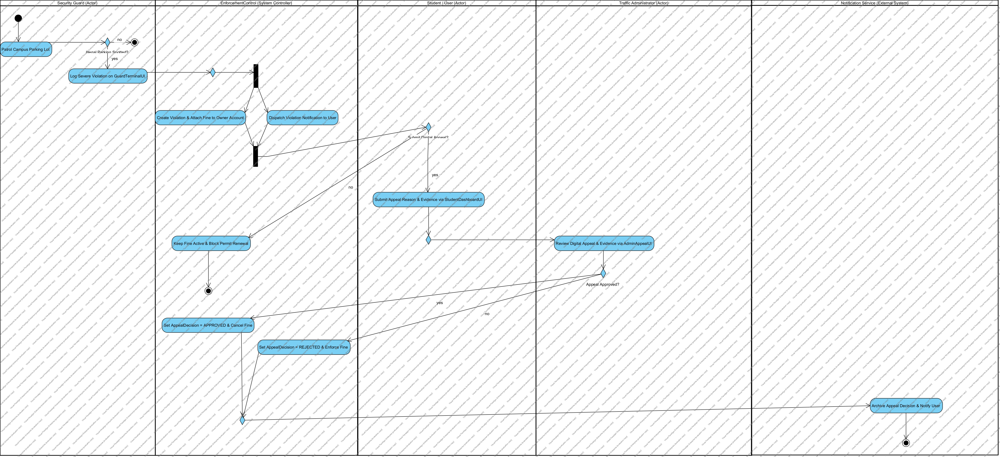
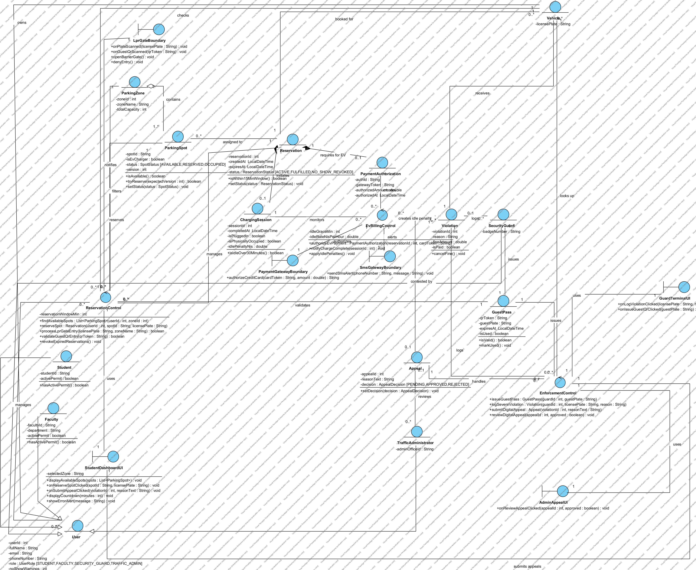
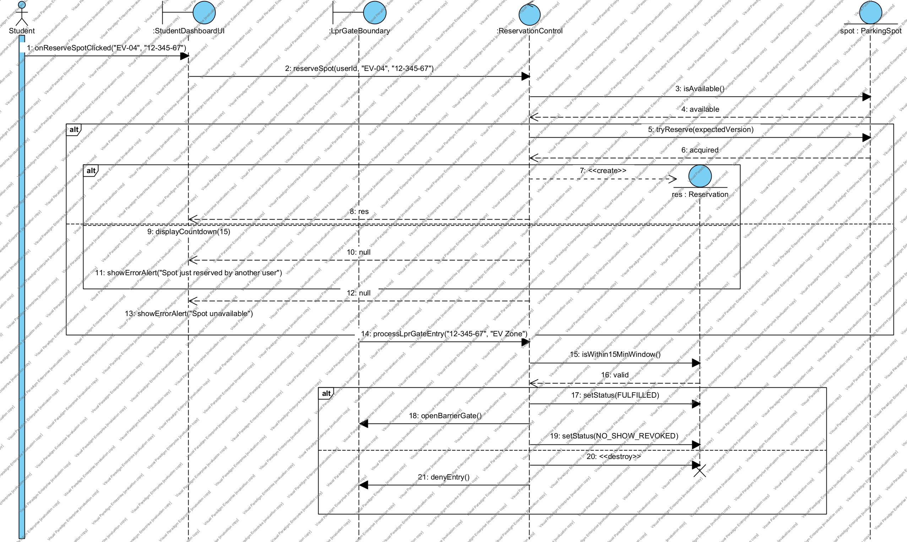
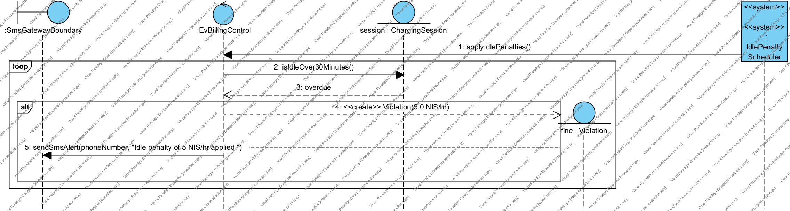

# System Architecture & Object-Oriented Design (`Ex4_SmartParking_Design`)

**Course:** 61756 Software Engineering Methods (Academic Year 2026-2027)
**Institution:** ORT Braude College of Engineering | Department of Software Engineering
**Domain:** Smart Campus Parking, LPR, and EV Network (Continued from Exercise 1)

---

## 1. Engineering Team Details

| Role | Full Name | Student ID | Braude Academic Email |
| :--- | :--- | :--- | :--- |
| **Student A (Role A)** | Dawlan Abuzeed | 214049785 | Dawlan.Abu.Zeed@braude.ac.il |
| **Student B (Role B)** | Mohamad Dabdoub | 214030090 | Mohamad.Dabdoub@braude.ac.il |

* **Group Number:** G10 / G14
* **GitHub Repository URL:** https://github.com/dawlanabuzeed/Ex4_SmartParking_Design

---

## 2. Step 1: Business Process Modeling — Activity Diagram (`Visual Paradigm`)

* **PlantUML Source:** [`diagrams/activity_appeal.puml`](diagrams/activity_appeal.puml)
* **Visual Paradigm Model:** [`SystemModel_Ex4.vpp`](SystemModel_Ex4.vpp)
* **Partitions / Swimlanes:** Five partitions separate the external **Actors** (`Security Guard`, `Student / User`, `Traffic Administrator`) from the internal **System Controller** (`EnforcementControl`) and the external **Notification Service** (`Notification Service (External System)`), using `initial node`, `fork`/`join` (AND), `decision` (XOR) with explicit `[guards]`, `merge` (OR), and `activity final node`.

* **Lecturer feedback applied:** archiving the appeal decision and notifying the user is not the System Controller's responsibility, so the final action `Archive Appeal Decision & Notify User` (and the activity final node) was moved into a fifth partition, `Notification Service (External System)`.



---

## 3. Step 2: Structural Modeling — ECB Class Diagram (`PlantUML` -> `Visual Paradigm`)

Following the **ECB (Entity-Control-Boundary)** architectural pattern:

| ECB Stereotype | Classes in System | Architectural Responsibility |
| :--- | :--- | :--- |
| **`<<boundary>>`** | `StudentDashboardUI`, `GuardTerminalUI`, `AdminAppealUI`, `LprGateBoundary`, `PaymentGatewayBoundary`, `SmsGatewayBoundary` | Interfaces with external Actors and external hardware/payment/SMS systems. Communicates ONLY with `<<control>>` classes. |
| **`<<control>>`** | `ReservationControl`, `EvBillingControl`, `EnforcementControl` | Multiple specialized controllers orchestrating business rules, timers, concurrency checks, and workflows. |
| **`<<entity>>`** | `User` (`Student`, `Faculty`, `SecurityGuard`, `TrafficAdministrator`), `GuestPass`, `Vehicle`, `ParkingZone`, `ParkingSpot`, `Reservation`, `PaymentAuthorization`, `ChargingSession`, `Violation`, `Appeal` (closed value sets are typed fields: `User.role : UserRole`, `ParkingSpot.status : SpotStatus`, `Reservation.status : ReservationStatus`, `Appeal.decision : AppealDecision`) | Passive domain data classes storing persistent business state and domain helper methods. |

* **PlantUML Source:** [`diagrams/class_diagram_ecb.puml`](diagrams/class_diagram_ecb.puml)
* **Visual Paradigm Model:** [`SystemModel_Ex4.vpp`](SystemModel_Ex4.vpp)

* **Note on the enumerations (lecturer feedback):** the four enumerations (`UserRole`, `SpotStatus`, `ReservationStatus`, `AppealDecision`) are not drawn as separate class-like boxes. Each one is modeled as a typed field inside its owning entity, with its allowed values listed in brackets, e.g. `- status : SpotStatus [AVAILABLE,RESERVED,OCCUPIED]`. This keeps the type names and all the values required by the Part 2 prompt.



---

## 4. Step 3: Behavioral Modeling — ECB Sequence Diagrams (`PlantUML` -> `Visual Paradigm`)

### 4.1 Sequence Diagram 1: Spot Reservation, LPR Gate Entry & No-Show Destruction
* **PlantUML Source:** [`diagrams/sequence_reservation_ecb.puml`](diagrams/sequence_reservation_ecb.puml)



### 4.2 Sequence Diagram 2: EV Charging 30-Minute Idle Penalty (`loop` & `<<create>>`)
* **PlantUML Source:** [`diagrams/sequence_idle_penalty_ecb.puml`](diagrams/sequence_idle_penalty_ecb.puml)



---

## 5. Independent AI Prompt & Architectural Design Critique (Part 4)

Prompt sent in Continue (Qwen2.5-Coder-7B-Instruct) with `SYSTEM_STORY.md`, `diagrams/class_diagram_ecb.puml` and `diagrams/sequence_reservation_ecb.puml` attached:

~~~text
Based strictly on the attached SYSTEM_STORY.md (Section 3: Edge Cases & Concurrency Rules), diagrams/class_diagram_ecb.puml and diagrams/sequence_reservation_ecb.puml, perform a strict UML 2.5 architectural design review of our ECB model for the 'Smart Campus Parking, LPR, and EV Network' system against the two approved edge cases:
1. Edge Case A (Double-Booking Race Condition):
   - Scenario: Two students simultaneously click Reserve on the last available spot in Student Zone at the exact same millisecond.
   - Verify that <<entity>> ParkingSpot declares the attribute version and the operation tryReserve(expectedVersion) for an atomic reservation check.
   - Verify that Sequence Diagram 1 calls Spot.tryReserve(expectedVersion) and models both branches: alt acquired == true (create Res with <<create>>, displayCountdown(15)) and else (Concurrent Race Condition: showErrorAlert("Spot just reserved by another user")).
2. Edge Case B (Physical vs. Electrical EV State):
   - Scenario: An EV driver unplugs the charging cable at minute 29 without physically moving the car out of the EV bay.
   - Verify that <<entity>> ChargingSession declares isPluggedIn separately from isPhysicallyOccupied, and that isIdleOver30Minutes() and EvBillingControl.applyIdlePenalties() base the 30-minute Charger Idle Penalty on isPhysicallyOccupied, not on isPluggedIn.
3. For each edge case report: Handled (YES/NO), the exact class, attribute, operation or message that proves it, and any gap found.
4. Suggest at most 3 concrete improvements to our diagrams (missing operations, missing messages, wrong multiplicities, or ECB rule violations).
Rules:
- Do NOT rewrite the full diagrams and do NOT use skinparam.
- Every method name you mention MUST match the exact method names declared in class_diagram_ecb.puml.
- For each improvement, output ONLY the exact PlantUML line(s) to add or change inside a ```plantuml block.
~~~

**Result of the review:**
* **Edge Case A (Race Condition) – handled:** `ParkingSpot` declares `version : int` and `tryReserve(expectedVersion : int) : boolean`, and Sequence Diagram 1 calls `tryReserve(expectedVersion)` with nested `alt acquired == true` / `else Concurrent Race Condition` branches, so only one simultaneous reservation succeeds.
* **Edge Case B (EV Physical Occupancy) – handled:** `ChargingSession` keeps `isPluggedIn` separate from `isPhysicallyOccupied`, and Sequence Diagram 2 applies the idle penalty only under `alt overdue == true (isPhysicallyOccupied == true)`, so unplugging at minute 29 without moving the car still triggers the 30-minute Charger Idle Penalty.
* **AI-suggested improvements:** we checked all three suggestions against our files and all of them were already present in the model (`isIdleOver30Minutes()` already exists on `ChargingSession`, the `Reservation` → `PaymentAuthorization` / `ChargingSession` multiplicities are already `"1" *-- "0..1"`, and the LPR gate flow it proposed is identical to ours). We also found two inaccuracies in the AI answer: it labeled the `ParkingSpot`–`Reservation` association `reserves` (ours is `assigned to`) and it used a message `isPhysicallyOccupied()` that is an attribute, not an operation, in our class diagram. Therefore no change was needed.

---

## 6. Notes on the Visual Paradigm PlantUML Import

* **Class diagram:** the course's Visual Paradigm PlantUML importer crashes when an enumeration is not connected to any class (PlantUML adds hidden layout links that the plugin treats as note anchors). After the import, the enumerations were turned into typed fields directly in Visual Paradigm, and `class_diagram_ecb.puml` was updated to match the model exactly.
* **Sequence diagrams:** the importer crashes on nested combined fragments (`alt` inside `alt`, `alt` inside `loop`), drops every message after `else`, and does not create combined-fragment frames at all. The `.puml` files in `diagrams/` are the complete versions required by the prompt; in Visual Paradigm the same messages were imported without fragments and the `alt` / `loop` frames, guards and the destruction marker were then added by hand.

---

## 7. License
Distributed under the **ORT Braude College Academic License** (61756 Software Engineering Methods, 2026-2027).
